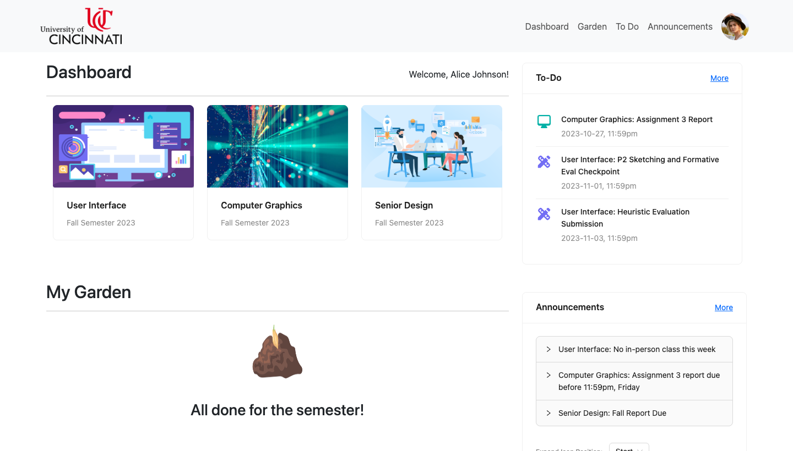
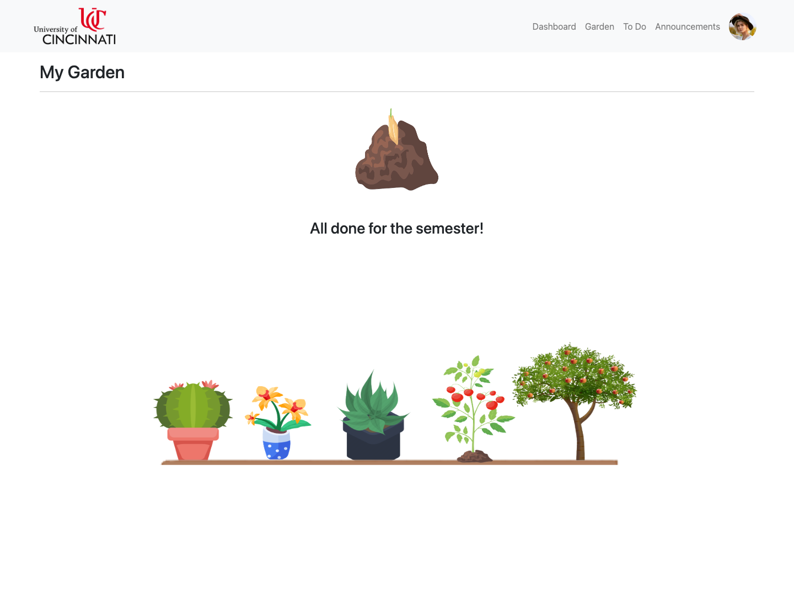

# Alterna-Canvas

[](https://react.dev/)
[](https://vitejs.dev/)
[](https://ant.design/)
[](https://react-bootstrap.netlify.app/)
[](https://reactrouter.com/)
[](https://aws.amazon.com/s3/)

A reimagining of **Canvas**, the university learning-management system, with a
gamified twist: as you keep up with your coursework, you grow a virtual garden.
Built as a UI design course project at the University of Cincinnati.

The premise is simple — most LMS dashboards are purely transactional. Alterna-Canvas
keeps the familiar Canvas surface (courses, syllabi, modules, grades, assignments,
files) but wraps it in a light habit loop that rewards consistent engagement.



## The garden mechanic

Staying on top of your work earns **water points**. Spend them to water your plant,
and it advances through growth stages — from a seedling to a fully grown apple tree
or tomato plant. Neglect it, though, and there are consequences:

> Water your plant at least once every two weeks. Miss that window and it wilts,
> resetting that plant's progress — a gentle nudge to keep showing up.

A finished plant graduates to your garden shelf, so the dashboard doubles as a
visual record of the semester.



## Features

| Area | What it does |
|------|--------------|
| **Dashboard** | Course cards, a to-do list, recent announcements, and your current plant at a glance. |
| **Course pages** | Per-course tabs for Syllabus, Modules, Grades, Assignments, Files, and Zoom. |
| **Garden** | The gamification layer — water points, growth stages, wilting, and a shelf of completed plants. |
| **To Do** | An aggregated view of upcoming work across all courses. |
| **Announcements** | A campus-wide announcements feed. |
| **Account** | Per-user profile, persisted so the experience follows the signed-in student. |

## How it fits together

The app is a single-page React front end. Two data sources sit behind it: a local
`json-server` for student/garden state, and AWS S3 for per-course file content.

```
                 ┌──────────────────────────────┐
                 │   React SPA (Vite)            │
                 │   Ant Design + React-Bootstrap│
                 └───────────────┬──────────────┘
                                 │
              ┌──────────────────┴───────────────────┐
              │                                       │
      ┌───────▼────────┐                     ┌────────▼────────┐
      │  json-server   │                     │     AWS S3      │
      │  students,     │                     │  course files   │
      │  garden state, │                     │  (syllabus,     │
      │  water points  │                     │  modules, etc.) │
      └────────────────┘                     └─────────────────┘
```

- **`json-server`** watches `src/data/users.json` and exposes a REST API for student
  records: courses, grades, water points, and current plant/garden imagery.
- **AWS S3** stores the file tree for each course. The S3 client reads credentials
  from `VITE_*` environment variables; if they are absent the app still runs and the
  file-backed tabs simply show an empty state.

## Running it locally

```bash
# 1. Install dependencies
npm install

# 2. (Optional) configure AWS S3 for course files
cp .env.example .env   # then fill in your values

# 3. Start the mock data API (leave this running)
npm run dev:server     # json-server on http://localhost:3030

# 4. In a second terminal, start the app
npm run dev            # Vite on http://localhost:5173
```

Then open the URL Vite prints (usually <http://localhost:5173>).

> The `.env` step is optional. Without AWS credentials the dashboard, garden,
> to-do, and announcements all work from local data — only the course **file**
> tabs need S3.

### Scripts

| Command | Description |
|---------|-------------|
| `npm run dev` | Start the Vite dev server. |
| `npm run dev:server` | Start `json-server` against `src/data/users.json`. |
| `npm run build` | Produce a production build in `dist/`. |
| `npm run preview` | Preview the production build locally. |
| `npm run lint` | Run ESLint (zero-warning policy). |

## Tech stack

- **React 18** + **Vite** for the SPA and build tooling
- **Ant Design 5** and **React-Bootstrap** for UI components
- **React Router 6** for client-side navigation
- **AWS S3** (`aws-sdk`) for course file storage
- **json-server** as a zero-config mock REST backend
- **Tailwind CSS** available for utility styling

## Team

Built by Anusha Chitranshi, Nishil Faldu, Athulya Ganesh, and Emma Gardner.

## Deployment

A static build (`npm run build`) deploys to any static host; the project was
originally hosted on Vercel (see `vercel.json`).
